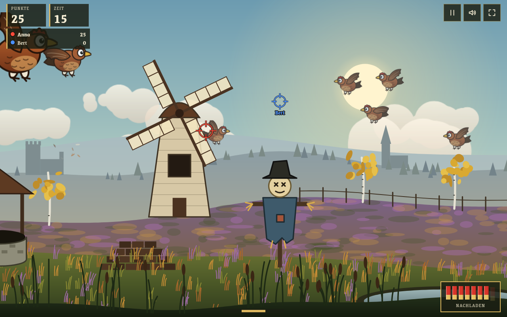
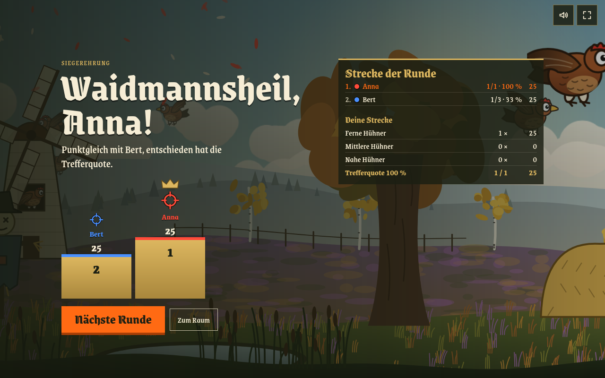

# 🐔 Moorjagd

Hühnerjagd im herbstlichen Moor: **90 Sekunden, 8 Patronen und ein Moor voller frecher Hühner.**
Ein Browserspiel in einer einzigen HTML-Datei, spielbar mit Maus, Tastatur oder Touch, allein oder mit anderen.

- **Eine Datei, keine Bibliotheken.** Grafik auf Canvas gezeichnet, Ton per Web Audio, Schriften eingebettet
- **Allein oder zu mehreren.** Bis zu 8 Jäger jagen im selben Moor, der Server entscheidet, wer zuerst trifft
- **Gemeinsame Bestenliste.** Kleiner Dienst mit SQLite, speichert keine IP-Adressen
- **Läuft auch ohne Server.** Dann bleibt die Streckenliste auf dem Gerät
- **Nur Python-Standardbibliothek.** Kein `pip install`, kein `npm install`, kein Build-Werkzeug

> Lizenz: [MIT](LICENSE). Die Schriften stehen unter der [SIL Open Font License 1.1](schriften/OFL.txt).



---

## Inhalt

- [🎯 Spielen](#-spielen)
  - [Bedienung](#bedienung) · [Punkte](#punkte) · [🔫 Patronen und Nachladen](#-patronen-und-nachladen) ·
    [👥 Mehrspieler](#-mehrspieler) · [📋 Streckenliste](#-streckenliste)
- [🧱 Aufbau](#-aufbau)
- [🚀 Selbst betreiben](#-selbst-betreiben)
  - [Nur das Spiel](#nur-das-spiel) · [Mit Bestenliste und Mehrspieler](#mit-bestenliste-und-mehrspieler) ·
    [Einstellungen](#einstellungen-env-variablen) · [Bestenliste verwalten](#bestenliste-verwalten)
- [🛡️ Datenschutz und Schummeln](#️-datenschutz-und-schummeln)
- [🧪 Prüfen](#-prüfen)
- [📄 Lizenz](#-lizenz)

---

## 🎯 Spielen

Eine Runde dauert **90 Sekunden**. Hühner fliegen in drei Entfernungen durchs Moor, dazu verstecken sich
welche in Mühle, Brunnen, Eiche und Heuhaufen. Ziel ist die höchste Strecke am Ende der Zeit.

### Bedienung

| | Maus und Tastatur | Touch |
|---|---|---|
| **Schießen** | Linksklick | Tippen |
| **Nachladen** | Rechtsklick, Leertaste oder `R` | Knopf **Nachladen** unten rechts |
| **Umsehen** | Maus an den Bildrand, Mausrad, Pfeiltasten oder `A`/`D` | Wischen |
| **Pause** | `Esc` oder `P` | Pause-Knopf oben rechts |

Oben rechts liegen außerdem Ton an/aus und Vollbild.

### Punkte

| Ziel | Punkte |
|---|---:|
| Huhn in der Ferne (klein) | **25** |
| Huhn in mittlerer Entfernung | **10** |
| Huhn ganz nah (groß) | **5** |
| Versteck: Mühle | **25** |
| Versteck: Eiche | **20** |
| Versteck: Brunnen, Heuhaufen | **15** |
| Ballon (kommt zweimal je Runde vorbei) | **50** |
| Wegweiser, je Schild (3 Schilder) | **10** |
| Vogelscheuche | **−25** |
| **Nachladen** | **−10** |

Am Ende zeigt die Strecke jeden Posten einzeln, auch wie oft nachgeladen wurde und was das gekostet hat.

### 🔫 Patronen und Nachladen

Das Magazin fasst **8 Patronen**. Leer geschossen klickt die Flinte nur noch, nachgeladen wird nie von selbst.

- **Jedes Nachladen kostet 10 Punkte**, so viel wie eine Schachtel Patronen.
- **Reste im Magazin sind verloren.** Wer nach 5 Schüssen nachlädt, zahlt trotzdem die vollen 10 Punkte.
- **Das erste Magazin ist frei.** Mit vollem Magazin geht Nachladen gar nicht.
- Nachladen dauert gut eine halbe Sekunde, so lange schießt die Flinte nicht.

Wildes Draufhalten lohnt sich also nicht: Ein Magazin für drei nahe Hühner (15 Punkte) bringt nach dem Nachladen
gerade noch 5. Erst ein fernes Huhn oder ein Versteck macht die Schachtel wett.

Im Mehrspieler zieht der **Server** die Kosten ab und zählt die Patronen mit. Ohne Nachladen nimmt er höchstens
8 Schüsse an.

### 👥 Mehrspieler

Im Menü **„Mit anderen jagen“** (nur mit Server, siehe [unten](#mit-bestenliste-und-mehrspieler)):

1. Einer **macht einen Raum auf** und ist damit Oberjäger. Andere **fragen an**, der Oberjäger nimmt sie an.
2. Der Oberjäger startet. Nach einem **Countdown 3–2–1** jagen alle 90 Sekunden lang im selben Moor.
   Jeder sieht die Fadenkreuze der anderen mit Namen und die laufende Punkteliste oben links.
3. Der Server lässt Hühner, Verstecke, Ballon und Schilder auftauchen. Bei zwei Schüssen auf dasselbe Ziel
   **gewinnt, wer zuerst trifft**.
4. Danach folgt die **Siegerehrung** mit Podest, Strecke der Runde und der eigenen Punktetabelle.
   Bei Punktgleichstand entscheiden die Treffer, dann die Trefferquote.

**Pausieren geht nicht**, die Zeit läuft für alle weiter. `Esc`, `P` oder der Pause-Knopf öffnen stattdessen
die Tafel **„Kurze Rast“**: Mit „Weiterjagen“ ist man sofort zurück, mit „Runde verlassen“ verlässt man den Raum.
Beim Oberjäger übernimmt dann der Nächste. Reißt die Verbindung ab, darf man 30 Sekunden lang zurückkommen
und behält seine Punkte.



### 📋 Streckenliste

Nach jeder Runde allein kann man seinen Namen eintragen. Die Liste zeigt die zehn besten Strecken.
Mit Server ist sie für alle gemeinsam, ohne Server liegt sie nur im Browser dieses Geräts (`localStorage`).
Mehrspieler-Runden kommen nicht in die Liste.

---

## 🧱 Aufbau

```
moorjagd.html                 das ganze Spiel
baue.py                       baut dist/moorjagd.html (eigenes Gerüst, Schriften eingebettet)
schriften/                    Grenze und Grenze Gotisch als woff2 + OFL.txt
dienst/
  moorjagd-strecken.py        Bestenliste (HTTP + SQLite) und Mehrspieler (WebSocket) in einem Dienst
  moorjagd-strecken.service   systemd-Unit mit DynamicUser und Härtung
  moorjagd-strecken.env.beispiel   Vorlage für die Einstellungen
  Caddyfile.beispiel          Beispiel für den Reverse-Proxy
  pruefe_dienst.py            Prüfung der Bestenliste
  pruefe_mehr.py              Prüfung des Mehrspieler-Protokolls
pruefung.mjs                  Browser-Prüfung allein (Firefox headless)
pruefung_mehr.mjs             Browser-Prüfung Mehrspieler (zwei Firefox-Fenster)
```

`moorjagd.html` lädt die Schriften noch von Google Fonts. `baue.py` bettet sie ein, damit die fertige Seite
keine Anfragen an fremde Server schickt. Dabei setzt es am `<html>`-Element `data-api="/api/moorjagd"`.
**Nur mit `data-api` sucht die Seite einen Server** und bietet „Mit anderen jagen“ an. Ohne läuft sie allein.

---

## 🚀 Selbst betreiben

### Nur das Spiel

```sh
python3 baue.py
```

Die erzeugte `dist/moorjagd.html` auf irgendeinen Webserver legen, fertig. Ohne erreichbaren Dienst meldet die
Seite, dass die gemeinsame Liste fehlt, und speichert die Strecken auf dem Gerät.

### Mit Bestenliste und Mehrspieler

Der Dienst läuft hinter einem Reverse-Proxy, der `/api/moorjagd/*` weiterleitet und `X-Forwarded-For` setzt.
Mit Caddy reicht das [Beispiel](dienst/Caddyfile.beispiel), WebSockets gehen ohne weitere Einstellung durch.

```sh
install -D -m 644 dienst/moorjagd-strecken.py /usr/local/lib/moorjagd/moorjagd-strecken.py
install -m 644 dienst/moorjagd-strecken.service /etc/systemd/system/
install -m 644 dienst/moorjagd-strecken.env.beispiel /etc/default/moorjagd-strecken
nano /etc/default/moorjagd-strecken          # mindestens MOORJAGD_HERKUNFT anpassen
systemctl daemon-reload
systemctl enable --now moorjagd-strecken
```

Die Daten liegen in `/var/lib/moorjagd/strecken.db`. Räume und laufende Runden liegen nur im Arbeitsspeicher
und sind nach einem Neustart weg.

### Einstellungen (ENV-Variablen)

| Variable | Voreinstellung | Bedeutung |
|---|---|---|
| `MOORJAGD_ADRESSE` | `127.0.0.1` | Adresse, auf der der Dienst lauscht |
| `MOORJAGD_PORT` | `8097` | Port |
| `MOORJAGD_VERTRAUT` | `127.0.0.1` | Nur Anfragen von dieser Adresse (dem Proxy) werden angenommen |
| `MOORJAGD_HERKUNFT` | `http://localhost:8000,http://127.0.0.1:8000` | Erlaubte Origins der Seite, kommagetrennt |
| `MOORJAGD_MINDESTDAUER` | `85` | So viele Sekunden muss eine Runde mindestens gedauert haben |
| `MOORJAGD_RUNDE` | `90` | Rundendauer im Mehrspieler in Sekunden (kürzer nur zum Testen) |
| `STATE_DIRECTORY` | `/var/lib/moorjagd` | Ordner für Datenbank und Geheimnis, setzt systemd selbst |

### Bestenliste verwalten

```sh
python3 -I /usr/local/lib/moorjagd/moorjagd-strecken.py --liste          # alle Einträge mit ID
python3 -I /usr/local/lib/moorjagd/moorjagd-strecken.py --loeschen ID    # einen Eintrag löschen
```

---

## 🛡️ Datenschutz und Schummeln

**Gespeichert** werden Name, Punkte, Treffer, Schüsse, Zeitpunkt und eine Runden-Kennung, **keine IP-Adressen**.
Für die Mengengrenzen hält der Dienst Adressen nur als gesalzene Prüfsumme im Arbeitsspeicher. Bei IPv6 zählt
das ganze /64.

**Hürden gegen Unfug:**

- Jede Runde holt sich vorher eine **Rundenmarke** vom Server (HMAC). Einlösbar frühestens nach 85 Sekunden
  und nur einmal.
- Höchstens **50 Punkte je Treffer**, nicht mehr Treffer als Schüsse.
- **Mengengrenzen:** 20 Einträge je Stunde und Anschluss, 500 am Tag insgesamt. Im Mehrspieler höchstens
  20 Räume, 8 Jäger je Raum und 60 Verbindungen.
- Der Dienst nimmt nur Anfragen vom Proxy und von den eingestellten Origins an.

**Das ist kein Betrugsschutz.** Allein gespielt entstehen die Punkte im Browser. Wer gezielt fälscht, kommt
durch. Im Mehrspieler rechnet dagegen der Server: Das Gerät meldet nur, worauf es geschossen hat.

---

## 🧪 Prüfen

```sh
python3 dienst/pruefe_dienst.py                       # Bestenliste mit Wegwerf-Datenbank
python3 dienst/pruefe_mehr.py                         # Mehrspieler-Protokoll mit simulierten Jägern
python3 baue.py
PRUEF_AUSGABE=$(mktemp -d) node pruefung_mehr.mjs     # zwei Firefox-Fenster spielen gegeneinander
PRUEF_AUSGABE=$(mktemp -d) node pruefung.mjs <Adresse der Seite>
```

Die Python-Prüfungen starten den Dienst selbst auf einem freien Port. Die Browser-Prüfungen brauchen
**Node.js ab Version 22** und **Firefox** und legen Bildschirmfotos im Ordner `PRUEF_AUSGABE` ab.

---

## 📄 Lizenz

Code unter der [MIT-Lizenz](LICENSE).
Die Schriften [Grenze](https://github.com/Omnibus-Type/Grenze) und
[Grenze Gotisch](https://github.com/Omnibus-Type/Grenze-Gotisch) von Omnibus-Type stehen unter der
[SIL Open Font License 1.1](schriften/OFL.txt).
